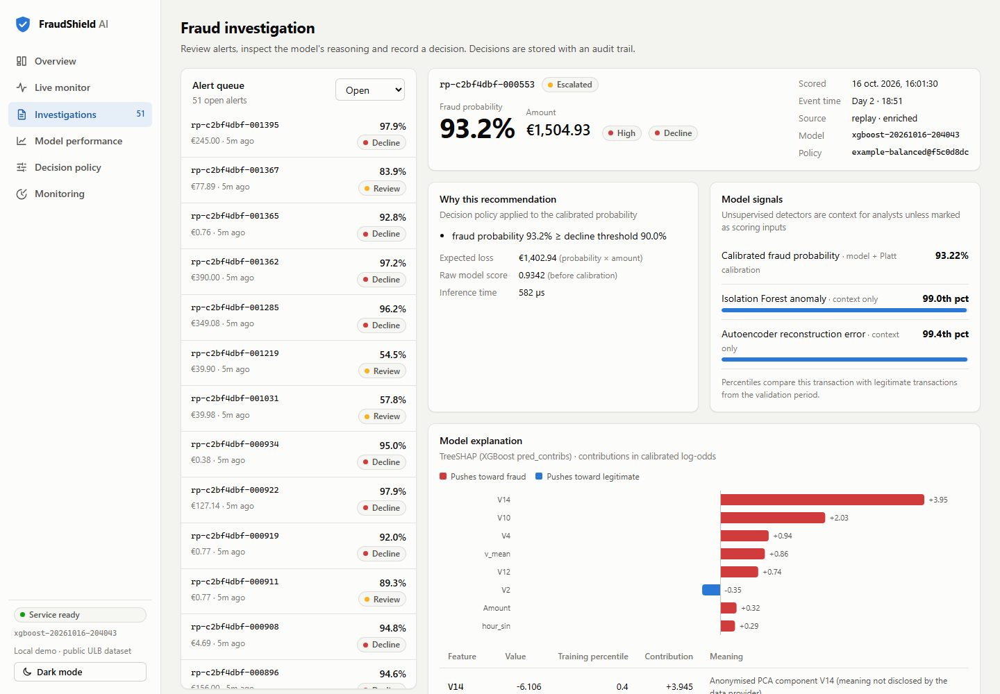
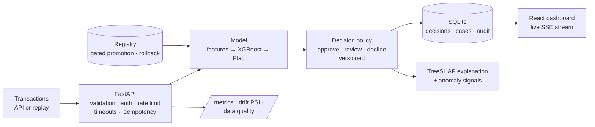

# FraudShield AI — real-time fraud intelligence platform

[](https://github.com/ARMAND-cod-eng/fraud-detection-ensemble/actions/workflows/ci.yml)


**Card fraud is rare (≈0.1–0.2% of payments), costly when missed and costly to over-flag; FraudShield
scores each transaction in under a millisecond, turns calibrated probabilities into auditable
decisions, and gives analysts the evidence to act — with every claim measured out-of-time.**



## Results at a glance (verified, held-out future window)

| | |
|---|---|
| Test PR-AUC (XGBoost, out-of-time) | **0.801** [95% CI 0.713–0.881] |
| Test ROC-AUC | **0.974** [0.954–0.991] |
| Recall at 0.1% false-positive rate | **81.1%** |
| At the validation-chosen review threshold | **94.5%** precision · **70.3%** recall · 55 alerts in 56,746 transactions |
| Illustrative fraud loss in the test window | €7,728 → **€3,716** with the example policy |
| Inference, one transaction (in-process p95) | **0.84 ms** |
| HTTP `POST /score`, Linux container | p50 **3.1 ms** · p95 4.8 ms · ~288 req/s per worker |
| Second dataset (IEEE-CIS, 590k transactions, separate benchmark) | test PR-AUC **0.508** [0.492–0.522] · ROC-AUC 0.887 |
| Tests | **58 automated tests** (unit + API integration), ruff, mypy, CI |

Data: ULB credit-card dataset (284,807 transactions, 48 h, 492 frauds), chronological
60/20/20 split, duplicates removed, every choice made on validation, test scored once.
Full report: [docs/ML_EVALUATION.md](docs/ML_EVALUATION.md).

### The honest headline: the ensemble did not earn its place

This project started as a notebook claiming an autoencoder + Isolation Forest + XGBoost ensemble.
Re-running it faithfully reproduced its headline ROC-AUC (0.983 vs claimed 0.9834) but exposed a
non-learning autoencoder, duplicate leakage, test-set threshold choices and an ROI driven by an
assumed $500 per fraud (the data's median fraud is €9). Rebuilt with leakage controls:

| Model (test) | PR-AUC [95% CI] | Δ vs XGBoost [95% CI] | p95 latency |
|---|---|---|---:|
| **XGBoost (selected)** | 0.801 [0.713, 0.881] | — | 0.84 ms |
| Stacked ensemble, out-of-fold | 0.808 [0.720, 0.886] | +0.006 [−0.003, +0.018] | 25–40 ms |
| Logistic regression | 0.789 [0.704, 0.870] | −0.012 [−0.045, +0.020] | 0.25 ms |
| XGBoost without engineered features | 0.791 [0.705, 0.872] | −0.011 [−0.035, +0.009] | — |
| Autoencoder (unsupervised) | 0.206 [0.137, 0.313] | −0.595 | — |
| Isolation Forest (unsupervised) | 0.058 [0.041, 0.083] | −0.744 | — |

A pre-registered rule (beat XGBoost by ≥ 0.01 validation PR-AUC with a CI excluding zero) rejected
the ensemble: no measurable gain for 30–40× the single-transaction latency. The anomaly detectors are kept as analyst
context, not as scoring inputs. Same pipeline on a *random* split reports PR-AUC 0.872 — random
splits flatter this problem. See [docs/PROJECT_AUDIT.md](docs/PROJECT_AUDIT.md).

### Second dataset: relationship features that drifted

The ULB data has no identifiers, so relationship ("graph") features were tested on
**IEEE-CIS** (590,540 transactions over 182 days, with card, address, e-mail and device-model
fields), as a separate benchmark:

| IEEE-CIS, out-of-time test | PR-AUC [95% CI] | Δ vs original columns [95% CI] |
|---|---|---|
| **Original columns (selected on validation)** | **0.508** [0.492, 0.522] | — |
| + entity counts since the start of the data | 0.498 [0.481, 0.512] | −0.010 [−0.015, −0.006] |
| + entity counts over trailing 24 h / 7 d windows | 0.505 [0.488, 0.518] | −0.004 [−0.008, +0.000] |

Cumulative counts only grow with time (test medians 3–4× training), a built-in train/serve
mismatch that hurt the model; trailing windows fixed the drift but added nothing, because the
vendor's own counting and time-delta columns already carry that signal. Details:
[benchmarks/results/ieee-cis/report.md](benchmarks/results/ieee-cis/report.md).

## What the platform does



1. **Scores** transactions (`POST /api/v1/transactions/score`, `/batch`) with a calibrated probability.
2. **Decides** with a separate, versioned policy (review / decline thresholds, review capacity,
   cost assumptions) — every decision stores the model and policy version.
3. **Explains** alerts with exact TreeSHAP attributions plus training-distribution percentiles,
   explicitly labelled as model associations, not evidence of fraud.
4. **Streams** a controlled replay of real held-out (or clearly synthetic) transactions with
   pause/resume, speed control, backpressure and failure isolation.
5. **Investigates**: alert queue, decision reasons, signals, audit trail, analyst decisions and
   notes; replayed history reveals its true label only after the analyst decides.
6. **Monitors** latency, throughput, errors, input/score drift (PSI) and out-of-range inputs;
   exports Prometheus metrics (Grafana dashboard provisioned).
7. **Governs models**: immutable artifacts with SHA-256 manifests, an evaluation gate before
   promotion, one-command rollback, optional MLflow tracking.

| Live monitor | Model performance |
|---|---|
|  |  |
| **Decision policy what-if** | **Monitoring under synthetic drift** |
|  |  |

## Quick start

**Requirements:** Python 3.12 (tested; 3.11+ intended), Node 20+ for the dashboard (built with Node 24), ~1.5 GB disk. CPU only.

```bash
git clone https://github.com/ARMAND-cod-eng/fraud-detection-ensemble.git && cd fraud-detection-ensemble
python -m venv .venv && . .venv/bin/activate              # Windows: .venv\Scripts\activate
pip install torch --index-url https://download.pytorch.org/whl/cpu
pip install -r requirements/dev.txt && pip install --no-deps -e .

fraudshield download-data        # Kaggle CLI if configured, else the public TF mirror; SHA-256 verified
fraudshield train --promote      # ~10 min on 8 cores (configs/training_fast.yaml: ~3 min)
cd dashboard && npm ci && npm run build && cd ..
uvicorn api.main:app --port 8000 # dashboard: http://localhost:8000 · API docs: /docs
```

**Docker** (after training once so `./artifacts` holds a promoted model):

```bash
docker compose up -d api                        # API + dashboard, non-root, read-only root fs
docker compose --profile monitoring up -d       # optional Prometheus :9090 + Grafana :3000
```

Then start a replay from the dashboard (Overview → *Transaction replay*). The 90-second walkthrough
is in [docs/DEMO_SCRIPT.md](docs/DEMO_SCRIPT.md).

## API examples

```bash
curl -s localhost:8000/api/v1/transactions/score -H 'Content-Type: application/json' -d '{
  "transaction_id": "txn_000123", "amount": 149.62, "time_seconds": 43200,
  "features": {"V1": -1.36, "V2": -0.07, "V3": 2.54, "V4": 1.38, "V5": -0.34, "V6": 0.46, "V7": 0.24,
    "V8": 0.10, "V9": 0.36, "V10": 0.09, "V11": -0.55, "V12": -0.62, "V13": -0.99, "V14": -0.31,
    "V15": 1.47, "V16": -0.47, "V17": 0.21, "V18": 0.03, "V19": 0.40, "V20": 0.25, "V21": -0.02,
    "V22": 0.28, "V23": -0.11, "V24": 0.07, "V25": 0.13, "V26": -0.19, "V27": 0.13, "V28": -0.02}}'
```

Response (real output from the trained model, numbers rounded):

```json
{
  "transaction_id": "txn_000123",
  "fraud_probability": 0.000257,
  "raw_model_score": 0.000364,
  "risk_level": "low",
  "recommended_action": "approve",
  "decision_reasons": ["fraud probability 0.03% below review threshold 53.34%"],
  "expected_loss_eur": 0.0384,
  "review_capacity_exceeded": false,
  "model_version": "xgboost-20261016-204043",
  "policy_version": "example-balanced@f5c0d8dc",
  "scored_at": "2026-10-16T21:23:31.771+00:00",
  "inference_ms": 0.95,
  "explanation_available": true,
  "explanation_url": "/api/v1/transactions/txn_000123/explanation",
  "data_quality_warnings": [],
  "synthetic": false,
  "idempotent_replay": false,
  "processing_ms": 1.99
}
```

| Endpoint | Purpose |
|---|---|
| `POST /api/v1/transactions/score` · `/batch` | Score one / up to 500 transactions (idempotent on `transaction_id`) |
| `GET /api/v1/transactions` · `/{id}` · `/{id}/explanation` | List/filter, detail + audit trail, TreeSHAP explanation |
| `POST /api/v1/transactions/{id}/review` | Analyst decision or note |
| `GET /api/v1/models/info` · `/evaluation` · `/versions` | Model metadata, offline report, registry history |
| `GET/PUT /api/v1/policy` · `POST /api/v1/policy/simulate` | Active policy, change it, what-if on held-out data |
| `POST /api/v1/replay/start` · `pause` · `resume` · `stop`, `PATCH /api/v1/replay` | Controlled replay |
| `GET /api/v1/overview` · `/monitoring` · `/stream` (SSE) | Dashboard aggregates and live events |
| `GET /health` · `/ready` · `/metrics` | Liveness, readiness (model verified + store + policy), Prometheus |

Errors always use `{"error": {"code", "message", "request_id"}}`; no stack traces leave the service.

## Training, evaluation and model operations

```bash
fraudshield train [--config configs/training.yaml] [--split chronological|stratified_random] [--promote]
fraudshield evaluate                         # reload production artifact, re-score test, compare (reproducibility)
fraudshield models list | show | promote --version V | rollback
python benchmarks/reproduce_legacy.py        # faithful re-run of the original notebook (5 seeds)
python benchmarks/policy_experiment.py       # threshold/cost experiment
python benchmarks/load_test.py               # HTTP load test against a running API
pytest -q                                    # 58 tests; trains a tiny model on synthetic data, no dataset needed
python benchmarks/ieee_cis_benchmark.py      # second dataset (needs Kaggle IEEE-CIS files, ~50 min CPU)
```

## Repository layout

```
src/fraudshield/   data · features · models · training · inference · decision_engine · monitoring · streaming · storage
api/               FastAPI app, routes, schemas, middleware (logging, request IDs, security headers, rate limiting)
dashboard/         React + TypeScript (Vite), hand-written SVG charts, no UI framework
tests/             unit · integration (API end to end) · performance (opt-in)
benchmarks/        legacy reproduction, policy experiment, load test, IEEE-CIS benchmark, results/
configs/           training.yaml, training_fast.yaml, decision_policy.yaml
deploy/            Prometheus, Grafana provisioning, AWS ECS task-definition template
docs/              audit, architecture, evaluation, model card, decision engine, deployment, trade-offs, demo
notebooks/         original exploratory notebook (kept for reference, with an audit note)
```

## Operational considerations

* **One worker by design.** Replay state, SSE fan-out, rate-limit buckets and drift windows live
  in process. ~240–290 req/s per instance on a laptop CPU; scaling out means Redis + Postgres.
* **Security:** strict input validation, optional API key for mutating endpoints, constant-time
  key check, per-client rate limiting, inference timeouts with idempotent retries, CSP/security
  headers, non-root read-only container, artifacts checksum-verified before any pickle is loaded,
  no feature values or analyst notes in logs. Not included: SSO/RBAC, TLS (see DEPLOYMENT).
* **Labels arrive late.** Live monitoring shows drift and alert-rate shifts, not "accuracy";
  performance on replayed history is labelled as simulated delayed labels.
* **AWS:** documented ECR → ECS Fargate (1 task) + S3 artifacts + CloudWatch design with a task
  definition template; **not provisioned** ([docs/DEPLOYMENT.md](docs/DEPLOYMENT.md)).

## Known limitations

* Two days of anonymised 2013 data; 57/74 frauds in validation/test → wide intervals.
* V1–V28 are PCA components without disclosed meaning; explanations cannot be phrased in business terms.
* Costs are assumptions; no real chargeback or review-cost data.
* No customer attributes → no fairness/subgroup analysis possible on this dataset.
* IEEE-CIS results come from a fixed XGBoost configuration (no tuning per variant) and one seed;
  its `DeviceInfo` field is a device model, not a device ID, so no true device graph is possible.

## Planned improvements

* Serve an IEEE-CIS model through the same API (needs a second feature schema).
* Redis/Postgres-backed state for multi-worker serving; shadow-mode evaluation of challenger models.
* Signed artifacts and S3-backed registry; SSO for the analyst UI.
* Seed-variance study for the stochastic models; conformal or Venn-Abers calibration comparison.

## Engineering trade-offs (short)

Chronological over random splits; PR-AUC over ROC-AUC; the simplest model that ties; native
TreeSHAP over the `shap` dependency; PyTorch for training only (NumPy inference, 725 MB image
without it); SQLite + in-process streaming over Kafka/Redis for a reviewer-runnable demo;
hand-written charts over chart libraries (88 kB gzipped UI). Details:
[docs/ENGINEERING_TRADEOFFS.md](docs/ENGINEERING_TRADEOFFS.md).

## Documentation

[Audit](docs/PROJECT_AUDIT.md) · [Architecture](docs/ARCHITECTURE.md) ·
[ML evaluation](docs/ML_EVALUATION.md) · [Model card](docs/MODEL_CARD.md) ·
[Decision engine](docs/DECISION_ENGINE.md) · [Deployment](docs/DEPLOYMENT.md) ·
[Trade-offs](docs/ENGINEERING_TRADEOFFS.md) · [Demo script](docs/DEMO_SCRIPT.md) ·
[Implementation log](docs/IMPLEMENTATION_PROGRESS.md) · [Resume bullets](docs/RESUME_BULLETS.md)

## Data and licence

Dataset: [Credit Card Fraud Detection](https://www.kaggle.com/datasets/mlg-ulb/creditcardfraud),
Machine Learning Group — ULB and Worldline (Database Contents License). The data is not
redistributed in this repository. Code: MIT.

**Author:** Armand Junior Dongmo Notue — [LinkedIn](https://www.linkedin.com/in/notue250/) ·
[Kaggle](https://www.kaggle.com/armandjunior) · notuearmand250@gmail.com
