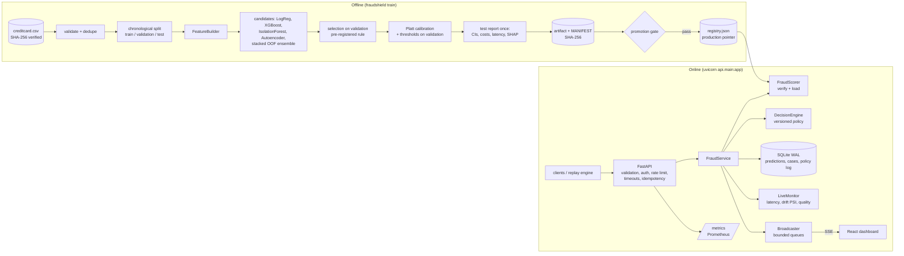

# Architecture

FraudShield is a single deployable service plus an offline training pipeline. Training, evaluation
and online inference are separate code paths that share exactly one feature implementation.



## Components

| Layer | Module | Responsibility |
|---|---|---|
| Data | `fraudshield.data.creditcard` | Schema/sanity validation, SHA-256, duplicate removal, out-of-time split |
| | `fraudshield.data.download` | Kaggle CLI or public mirror, checksum-verified |
| | `fraudshield.data.ieee_cis` | Second dataset loader + past-only entity/graph features |
| | `fraudshield.data.synthetic` | Schema-shaped random data for tests and CI only |
| Features | `fraudshield.features.engineering` | One row-local transform for batch and single-row use; training profile for data-quality checks and percentile context |
| Models | `fraudshield.models.*` | XGBoost / logistic / Isolation Forest / autoencoder (NumPy inference), Platt calibration, `FraudModel` composition, TreeSHAP attributions |
| | `fraudshield.models.artifact` | Immutable versioned artifacts, MANIFEST checksums, file registry |
| Training | `fraudshield.training.pipeline` | Candidates, selection, calibration, thresholds, test report, latency |
| | `fraudshield.training.evaluate` | Ranking/threshold/calibration metrics, bootstrap CIs, cost curves |
| | `fraudshield.training.promotion` | Evaluation gate, promote, rollback |
| Inference | `fraudshield.inference.scorer` | Load verified artifact, score, explain, data-quality warnings |
| Policy | `fraudshield.decision_engine` | Probability → action under a versioned, configurable policy; offline simulation |
| Service | `fraudshield.service` | Orchestrates idempotency → score → decide → persist → telemetry → broadcast |
| Storage | `fraudshield.storage.store` | SQLite (WAL): predictions, analyst case events, policy history |
| Streaming | `fraudshield.streaming` | Replay engine (pacing, backpressure, failure isolation), SSE broadcaster |
| Monitoring | `fraudshield.monitoring` | Prometheus metrics, rolling latency/throughput/error stats, PSI drift |
| API | `api/` | FastAPI routes, Pydantic contracts, error envelope, auth, rate limiting, logging |
| UI | `dashboard/` | React + TypeScript, no UI/chart libraries; served by the API in production |

## Request lifecycle — `POST /api/v1/transactions/score`

1. `RequestContextMiddleware` assigns/propagates `X-Request-ID`, times the request, adds security headers.
2. Pydantic validates the body (28 finite PCA features, amount ≥ 0, ID pattern, no extra fields).
3. Optional API-key check (constant-time compare) and per-client token-bucket rate limit.
4. `FraudService.score` runs in the thread pool under `asyncio.wait_for(FRAUDSHIELD_INFERENCE_TIMEOUT_MS)`.
   * Idempotency: a known `transaction_id` with the same payload hash returns the stored result;
     a different payload returns `409`. Because a timed-out call may still complete, retries with
     the same ID are always safe.
   * Features → model → Platt calibration (≈0.6 ms in-process for XGBoost).
   * The policy maps probability (and amount, if enabled) to approve / review / decline with reasons.
   * Alerts get TreeSHAP explanations and anomaly signals computed eagerly; approvals on demand.
   * Persist (one transaction per batch), update monitors and Prometheus, publish an SSE event.
5. Response follows the `ScoreOut` schema; errors follow `{"error": {code, message, request_id}}`
   and never contain stack traces.

## Real-time replay

`ReplayEngine` streams held-out (or explicitly synthetic) transactions into the same
`FraudService.score` path. A producer paces rows at the requested rate into a bounded
`asyncio.Queue`; when scoring falls behind, `queue.put` blocks (backpressure) and the wait is
counted. Two workers drain micro-batches of up to 50 rows into the thread pool with a timeout.
20 consecutive failures stop the run in a `failed` state. Pause / resume / rate change / stop are
exposed over the API. Row order and perturbations derive from the seed (reproducible scenarios).

## Live updates

The broadcaster gives each SSE subscriber its own bounded queue; a slow browser drops its oldest
events (counted and shown) instead of slowing scoring. The dashboard batches incoming events
into 400 ms frames so 200 tx/s does not mean 200 React renders per second.

## Persistence

```
predictions(transaction_id PK, payload_hash, received_at, event_time, amount, fraud_probability,
            raw_score, risk_level, action, reasons JSON, expected_loss, over_capacity,
            model_version, policy_version, latency_ms, source, synthetic, scenario,
            ground_truth NULL, features JSON, explanation JSON, signals JSON, quality JSON,
            review_status)
case_events(id, transaction_id, at, actor, event, decision, notes)        -- analyst audit trail
policy_history(version, at, actor, config JSON)                          -- decision-policy log
```

Every decision row records the model version and policy version that produced it. Replayed
historical rows keep their label in `ground_truth`; the API reveals it only after an analyst has
closed the case, simulating delayed chargeback labels without leaking the answer into the UI.

## Security controls (implemented)

* Input validation and size limits on every endpoint; batch limit configurable.
* Optional API key for mutating endpoints (`FRAUDSHIELD_API_KEY`), constant-time comparison.
* Error envelope without internals; structured JSON logs without feature values or notes.
* Security headers + CSP on the dashboard; CORS restricted to configured origins.
* Artifact SHA-256 verification **before** any pickle-based component is deserialised.
* Container: non-root user, read-only root filesystem in Compose, `no-new-privileges`.

Not implemented (would be required for production): SSO/RBAC for analysts, TLS termination,
secrets manager integration, audit-log shipping, multi-tenant isolation. See `DEPLOYMENT.md`.

## Visual language

The dashboard and report figures share one token set: a validated categorical order
(blue, orange, aqua, yellow, magenta — light and dark steps selected separately and checked for
colour-vision-deficiency separation), a reserved status palette (good / warning / critical) that
always ships with a label, hairline solid gridlines, 2 px lines, ≤24 px bars with rounded data
ends, one y-axis per chart and a legend for every multi-series chart.
