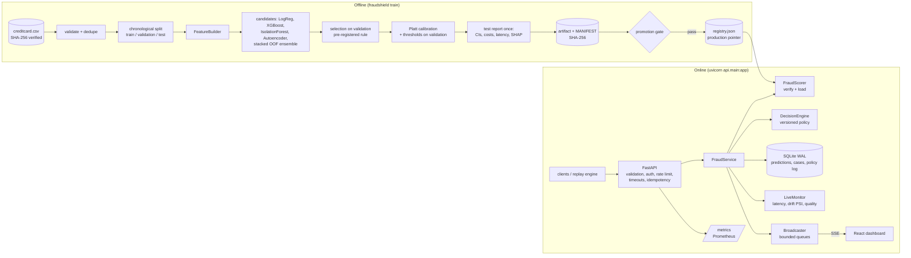
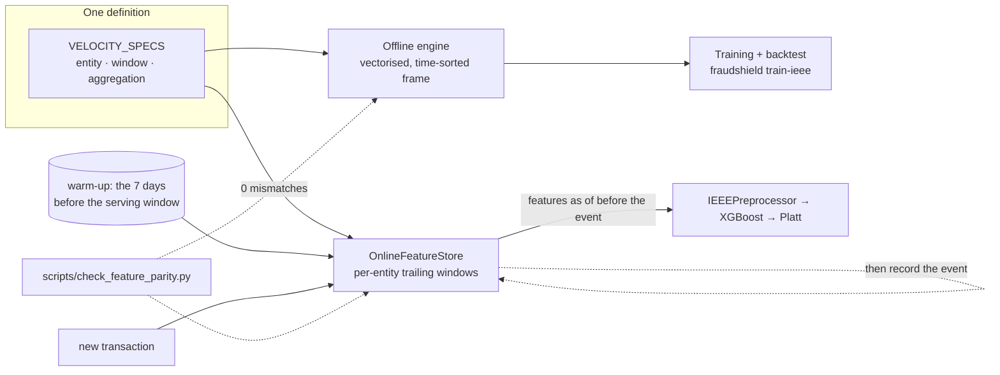

# Architecture

FraudShield is a single deployable service plus offline training pipelines. Training, evaluation
and online inference are separate code paths that share exactly one feature implementation.
The service is dataset-agnostic: a **data profile** (`FRAUDSHIELD_PROFILE`) supplies everything
that depends on the data. `creditcard` (ULB, the default) scores each transaction on its own;
`ieee` (FraudShield v2) adds velocity features from an online feature store, linked activity and
plain-language reason codes. See [Data profiles and the online feature store](#data-profiles-and-the-online-feature-store-v2).



## Components

| Layer | Module | Responsibility |
|---|---|---|
| Data | `fraudshield.data.creditcard` | Schema/sanity validation, SHA-256, duplicate removal, out-of-time split |
| | `fraudshield.data.download` | Kaggle CLI or public mirror, checksum-verified |
| | `fraudshield.data.ieee_cis` | IEEE-CIS loaders: full v1 benchmark, and the v2 authorisation-time field contract |
| | `fraudshield.data.synthetic` | Schema-shaped random data for tests and CI only |
| Features | `fraudshield.features.engineering` | One row-local transform for batch and single-row use; training profile for data-quality checks and percentile context |
| | `fraudshield.features.velocity` | v2: velocity features declared once (`VelocitySpec`), with a vectorised offline engine and an `OnlineFeatureStore`; parity proven by tests and on real data |
| Profiles | `fraudshield.profiles` | `creditcard` / `ieee` serving profiles: field contract, online enrichment, quality checks, entity keys, replay sources, analyst text; `IEEEPreprocessor` |
| Models | `fraudshield.models.*` | XGBoost / logistic / Isolation Forest / autoencoder (NumPy inference), Platt calibration, `FraudModel` composition, TreeSHAP attributions |
| | `fraudshield.models.artifact` | Immutable versioned artifacts, MANIFEST checksums, file registry |
| Training | `fraudshield.training.pipeline` | Candidates, selection, calibration, thresholds, test report, latency |
| | `fraudshield.training.evaluate` | Ranking/threshold/calibration metrics, bootstrap CIs, cost curves |
| | `fraudshield.training.ieee_v2` | v2: raw vs raw + velocity, pre-registered selection, calibration, monthly backtest, artifact + replay/warm-up files |
| | `fraudshield.training.promotion` | Evaluation gate (limits from the config in force), promote, rollback |
| Inference | `fraudshield.inference.scorer` | Load verified artifact, score, explain, data-quality warnings |
| Policy | `fraudshield.decision_engine` | Probability → action under a versioned, configurable policy; offline simulation |
| Service | `fraudshield.service` | Orchestrates idempotency → score → decide → persist → telemetry → broadcast |
| Storage | `fraudshield.storage.store` | SQLite (WAL): predictions, analyst case events, policy history |
| Streaming | `fraudshield.streaming` | Replay engine (pacing, backpressure, failure isolation), SSE broadcaster |
| Monitoring | `fraudshield.monitoring` | Prometheus metrics, rolling latency/throughput/error stats, PSI drift |
| API | `api/` | FastAPI routes, Pydantic contracts, error envelope, auth, rate limiting, logging |
| UI | `dashboard/` | React + TypeScript, no UI/chart libraries; served by the API in production |

## Request lifecycle — `POST /api/v1/transactions/score`

1. `RequestContextMiddleware` assigns/propagates `X-Request-ID`, times the request, adds security headers.
2. Pydantic validates the body against the active profile's contract (`creditcard`: 28 finite
   PCA features; `ieee`: the authorisation-time fields, all optional except amount and time), plus
   amount ≥ 0, ID pattern and no extra fields. The OpenAPI schema shows only the served contract.
3. Optional API-key check (constant-time compare) and per-client token-bucket rate limit.
4. `FraudService.score` runs in the thread pool under `asyncio.wait_for(FRAUDSHIELD_INFERENCE_TIMEOUT_MS)`.
   * Idempotency: a known `transaction_id` with the same payload hash returns the stored result;
     a different payload returns `409`. Because a timed-out call may still complete, retries with
     the same ID are always safe.
   * Online features (`ieee` only): for each *new* transaction the feature store reads the
     velocity features as of before the event, then records it (`score_and_update`, one lock).
     Known IDs never reach the store, so idempotent retries cannot double-count.
   * Features → model → Platt calibration (≈0.6 ms in-process for XGBoost; ≈0.8 ms p50 including
     the feature-store lookup for v2).
   * The policy maps probability (and amount, if enabled) to approve / review / decline with reasons.
   * Alerts get TreeSHAP explanations and anomaly signals computed eagerly; approvals on demand.
     The strongest risk-increasing factors are rendered as sentences (`top_risk_factors`), e.g.
     "14 earlier transactions on this card in the last 24 h (typical: 6)".
   * Persist (one transaction per batch), update monitors and Prometheus, publish an SSE event.
5. Response follows the `ScoreOut` schema; errors follow `{"error": {code, message, request_id}}`
   and never contain stack traces.

## Real-time replay

`ReplayEngine` streams held-out (or explicitly synthetic) transactions into the same
`FraudService.score` path. A producer paces rows at the requested rate into a bounded
`asyncio.Queue`; when scoring falls behind, `queue.put` blocks (backpressure) and the wait is
counted. Two workers drain micro-batches of up to 50 rows into the thread pool with a timeout
(one worker for the `ieee` profile, so events reach the feature store in time order).
20 consecutive failures stop the run in a `failed` state. Pause / resume / rate change / stop are
exposed over the API. Row order and perturbations derive from the seed (reproducible scenarios).

## Live updates

The broadcaster gives each SSE subscriber its own bounded queue; a slow browser drops its oldest
events (counted and shown) instead of slowing scoring. The dashboard batches incoming events
into 400 ms frames so 200 tx/s does not mean 200 React renders per second.

## Persistence

```
predictions(transaction_id PK, payload_hash, received_at, event_time, amount, fraud_probability,
            raw_score, risk_level, action, reasons JSON, expected_loss, over_capacity,
            model_version, policy_version, latency_ms, source, synthetic, scenario,
            ground_truth NULL, features JSON, explanation JSON, signals JSON, quality JSON,
            review_status, top_reasons JSON)
entity_links(entity_type, entity_hash, transaction_id, event_time)      -- linked activity (ieee)
case_events(id, transaction_id, at, actor, event, decision, notes)        -- analyst audit trail
policy_history(version, at, actor, config JSON)                          -- decision-policy log
```

Every decision row records the model version and policy version that produced it. Replayed
historical rows keep their label in `ground_truth`; the API reveals it only after an analyst has
closed the case, simulating delayed chargeback labels without leaking the answer into the UI.

## Data profiles and the online feature store (v2)



**One definition, two engines.** Each velocity feature is a `VelocitySpec` (entity fields, trailing
window, aggregation: count, amount sum, distinct values, seconds since previous, amount ÷ trailing
mean). The offline engine computes all of them over a time-sorted frame with sorted-array searches
and per-entity cumulative sums; the online store keeps, per entity key and window, a deque of
events with running sums and distinct counters, evicting on read. Semantics are point-in-time:
the window is `[t − W, t]` over *earlier* events, and a missing entity field gives a missing
feature rather than a zero.

**Parity is tested, not assumed.** Hand-computed unit tests; Hypothesis property tests that the
online store equals the offline engine on random event streams (including ties and float edge
cases that the tests found and the code now handles); future events cannot change past features;
and `scripts/check_feature_parity.py` streams the real IEEE-CIS test window (118,108 transactions,
after warming the store with the preceding 7 days) and compares every value with the offline
features used in training: **0 mismatches out of 1,771,620**.

**Serving.** The store is warmed at startup from `artifacts/ieee/replay/ieee_warmup.csv.gz`.
Events must arrive in time order: an event older than the stream watermark is processed at the
watermark and flagged in `data_quality_warnings`. The stored features of every prediction include
the velocity values as they were at scoring time, so later explanations are reproducible without
touching the store.

**Linked activity.** Each prediction writes hashed entity keys (card, card + e-mail domain,
card + billing region, device model) to `entity_links` in the same database transaction.
`GET /api/v1/transactions/{id}/linked` returns, per key, how many transactions share it (earlier,
in the 24 h before, in total) and the nearest ones with their scores and case status. Device
model is labelled a weak link: `DeviceInfo` is a model string shared by many customers.

**Scaling path (not implemented).** The store is in-process, so the `ieee` profile runs as a
single instance. Several instances would put the same structures in Redis (a sorted set per
entity key and window, `ZREMRANGEBYSCORE` + `ZADD` + counters in one Lua script for the atomic
read-then-write), with warm-up replaced by the store's own persistence.

## Security controls (implemented)

* Input validation and size limits on every endpoint; batch limit configurable.
* Optional API key for mutating endpoints (`FRAUDSHIELD_API_KEY`), constant-time comparison.
* Error envelope without internals; structured JSON logs without feature values or notes.
* Security headers + CSP on the dashboard; CORS restricted to configured origins.
* Artifact SHA-256 verification **before** any pickle-based component is deserialised.
* Container: non-root user, read-only root filesystem in Compose, `no-new-privileges`.

Not implemented (would be required for production): SSO/RBAC for analysts, TLS termination,
secrets manager integration, audit-log shipping, multi-tenant isolation. See `DEPLOYMENT.md`.

## Visual language

The dashboard and report figures share one token set: a validated categorical order
(blue, orange, aqua, yellow, magenta — light and dark steps selected separately and checked for
colour-vision-deficiency separation), a reserved status palette (good / warning / critical) that
always ships with a label, hairline solid gridlines, 2 px lines, ≤24 px bars with rounded data
ends, one y-axis per chart and a legend for every multi-series chart.
