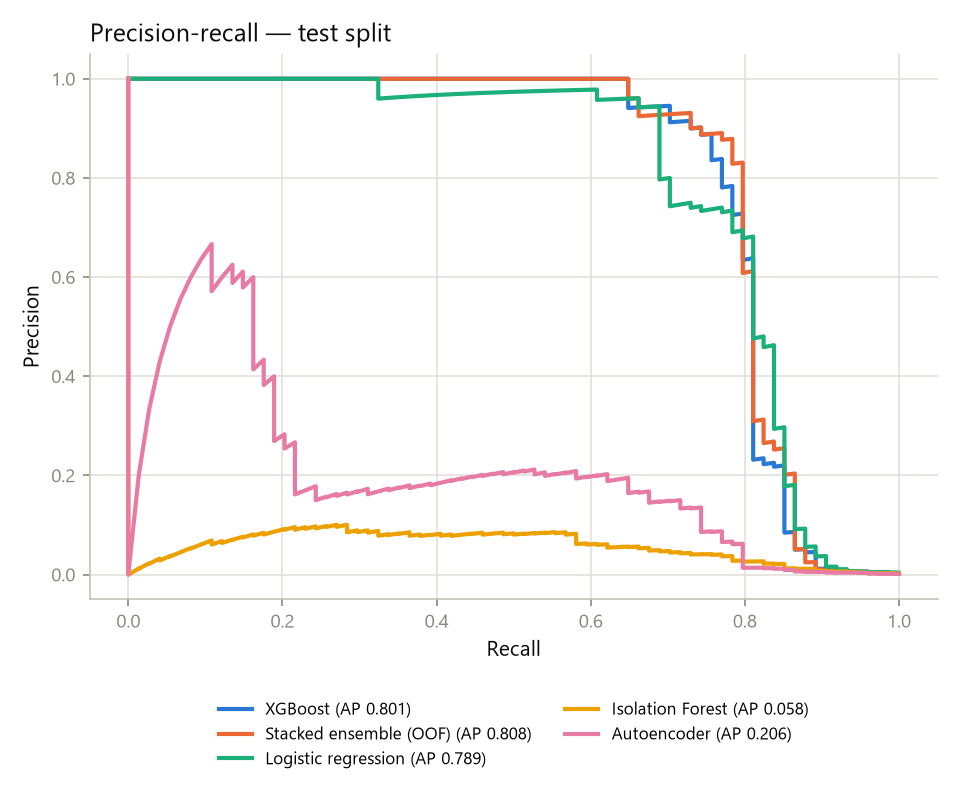

# ML evaluation report

All numbers in this document were produced by code in this repository on 2026-10-16 and can be
regenerated with the commands in §10. Machine-readable results:
`benchmarks/results/creditcard-chronological/metrics.json` (+ `report.md`, `figures/`).

## 1. Question

Can we rank card transactions so that a small, fixed review budget catches most fraud — and does
the original project's ensemble (autoencoder + Isolation Forest + XGBoost) beat simpler models
when evaluated without leakage?

## 2. Data

ULB credit-card dataset (Worldline / ULB, September 2013, European cardholders; 284,807
transactions over 48 h, 492 frauds). Features: 28 anonymised PCA components (V1–V28), `Amount`,
`Time` (seconds since the first transaction). SHA-256 `76274b69…` is verified on load.

* 1,081 exact duplicate rows (19 fraud) are removed before splitting → 283,726 rows, 473 frauds.
* **Limitation:** two days of data. The test window is ~7.7 hours; the out-of-time split guards
  against look-ahead but cannot measure seasonal or long-horizon drift.
* **Limitation:** no card, merchant or device identifiers → no velocity or relationship features,
  and no graph analysis on this dataset.

## 3. Protocol and leakage controls

| Split (chronological) | Rows | Frauds | Fraud rate | Hours |
|---|---:|---:|---:|---|
| Train | 170,235 | 342 | 0.201% | 0.0–33.4 |
| Validation | 56,745 | 57 | 0.100% | 33.4–40.3 |
| Test | 56,746 | 74 | 0.130% | 40.3–48.0 |

| Risk | Control |
|---|---|
| Future information | Out-of-time split; split points never cut through a shared timestamp |
| Preprocessing fit on test | Feature transforms are row-local; the only fitted statistics (training profile, autoencoder scaler) come from training data |
| Duplicates across splits | Removed before splitting |
| Tuning on test | Hyper-parameters, model choice, calibration and thresholds use validation only; early stopping uses a 15% slice of *train* |
| Stacking leakage | Detector scores for training rows are out-of-fold (4 folds); an in-sample variant is kept only as a reference |
| Autoencoder isolation | Trained on training normals only; scaler fit on those rows; early stopping on a held-out slice of them |
| Selection bias | Pre-registered rule (configs/training.yaml): a more complex model must beat XGBoost by ≥ 0.01 validation PR-AUC **and** the paired-bootstrap 90% CI of the gain must exclude 0 |
| Single test look | Test is scored once, after all choices were frozen; the run was repeated once after a plotting fix and reproduced every metric exactly |

## 4. Candidates

| Model | Details |
|---|---|
| Logistic regression | Standardised features; grid C ∈ {0.01, 0.1, 1} × class weight ∈ {none, balanced} → C=0.01, balanced |
| XGBoost | 8-config grid (depth, min child weight, `scale_pos_weight`), lr 0.05, early stopping on PR-AUC → depth 5, `scale_pos_weight`=1, 103 trees |
| XGBoost (raw features) | Ablation: V1–V28 + Amount only, same hyper-parameters |
| Isolation Forest | 200 trees, 256 samples/tree, unsupervised |
| Autoencoder | 37→32→16→8→16→32→37, ReLU, linear output, trained on normals; holdout MSE 0.60 → 0.25 (the legacy model never left 1418) |
| Stacked ensemble | XGBoost on features + out-of-fold Isolation Forest and autoencoder scores (the original design, fixed) |
| Stacked, in-sample | Same with in-sample detector scores (legacy leakage pattern; reference only) |

## 5. Results

### Validation (used for selection)

| Model | PR-AUC | ROC-AUC |
|---|---:|---:|
| XGBoost | 0.789 | 0.967 |
| Stacked ensemble (OOF) | 0.791 | 0.973 |
| Logistic regression | 0.785 | 0.977 |
| XGBoost (raw features) | 0.790 | 0.977 |
| Autoencoder | 0.083 | 0.945 |
| Isolation Forest | 0.027 | 0.943 |

Selection log: stacked gain +0.0015 (90% CI low −0.0103) → does not qualify; logistic −0.0042 →
does not qualify → **XGBoost selected**.

### Test (scored once; 95% bootstrap CIs, 1,000 resamples)

| Model | PR-AUC [95% CI] | ROC-AUC [95% CI] | Recall @ FPR 0.1% | Recall @ FPR 1% | Precision @ top 0.1% (k=57) |
|---|---|---|---:|---:|---:|
| **XGBoost (selected)** | **0.801** [0.713, 0.881] | 0.974 [0.954, 0.991] | 81.1% | 85.1% | 91.2% |
| Stacked ensemble (OOF) | 0.808 [0.720, 0.886] | 0.971 [0.950, 0.990] | 81.1% | 86.5% | 93.0% |
| Logistic regression | 0.789 [0.704, 0.870] | 0.980 [0.966, 0.993] | 81.1% | 86.5% | 89.5% |
| XGBoost (raw features) | 0.791 [0.705, 0.872] | 0.983 [0.970, 0.994] | 79.7% | 86.5% | 89.5% |
| Stacked, in-sample (legacy) | 0.799 [0.711, 0.881] | 0.971 [0.950, 0.989] | 81.1% | 83.8% | 93.0% |
| Autoencoder | 0.206 [0.137, 0.313] | 0.935 [0.897, 0.968] | 21.6% | 74.3% | 26.3% |
| Isolation Forest | 0.058 [0.041, 0.083] | 0.953 [0.928, 0.976] | 0.0% | 58.1% | 0.0% |

Paired bootstrap, test PR-AUC difference vs XGBoost: stacked **+0.006 [−0.003, +0.018]**
(P(Δ≤0)=0.09); logistic −0.012 [−0.045, +0.020]; raw features −0.011 [−0.035, +0.009].



### Answers

* **Does the ensemble help?** Not measurably. Its validation gain is +0.0015 and its test gain
  +0.006, both within noise, while single-transaction latency rises from 0.84 ms to ~25–40 ms p95
  (Isolation Forest scoring). The detectors are kept as *analyst context* (percentile vs. normal
  traffic in the investigation view), not as scoring inputs.
* **Does feature engineering help?** Not measurably (−0.011 [−0.035, +0.009] without it). The
  legacy notebook's "~15% improvement from feature engineering" is not supported.
* **Is XGBoost needed at all?** Logistic regression is within noise on PR-AUC and slightly better
  on ROC-AUC. XGBoost was selected by the pre-registered rule; a linear model is a defensible
  production alternative (0.12 ms latency, trivially explainable).
* **Unsupervised detectors alone** rank frauds far worse (PR-AUC 0.06–0.21), as expected when
  labels are available — their potential value is for novel patterns, which this data cannot test.

## 6. Operating point, calibration and cost

**Review threshold 0.533** (calibrated probability), chosen on validation as the cost-minimising
threshold under illustrative assumptions (€5 per review, missed fraud loses its amount):

| Test metric | Value [95% CI] |
|---|---|
| Precision | 94.5% [87.8%, 100%] |
| Recall | 70.3% [60.6%, 80.3%] |
| Alerts | 55 of 56,746 transactions (0.097%) |
| Confusion matrix | TP 52 · FP 3 · FN 22 · TN 56,669 |

The remaining frauds are hard to reach: on validation, recall only rises from 80.7% to 82.5% when
the false-positive rate is allowed to grow tenfold (0.1% → 1%), and the cost-optimal thresholds do
not move for review costs between €1 and €50 (`benchmarks/results/policy_experiment.md`).
Lowering the threshold buys reviews, not catches.

**Calibration (Platt, fit on validation):** XGBoost without class re-weighting was already well
calibrated; Platt barely changed it (a=1.03, b=−0.11). Test Brier 0.000393 → 0.000394,
ECE 0.00021 → 0.00020. Bins with ≥ 40 transactions track observed rates (e.g. predicted 94% →
observed 100% in the 0.9–1.0 bin, n=40). Small high-probability bins are too sparse for precise
calibration claims.

**Cost (illustrative):** approving everything loses €7,728 of fraud in the test window; the
validation-chosen policy costs €3,716–3,916 depending on the decline rule. See
[DECISION_ENGINE.md](DECISION_ENGINE.md).

## 7. Latency and throughput

| Measurement | Result |
|---|---|
| In-process, one transaction (features + XGBoost + calibration) | p50 0.55 ms · p95 0.84 ms |
| In-process, logistic / stacked | p95 0.25 ms / 25–40 ms |
| In-process batch | ~350k rows/s (XGBoost) |
| Full service path in-process (+ policy, SQLite write, telemetry) | p50 ≈ 1.0 ms |
| HTTP `POST /score`, Linux container, 1 client | p50 3.1 ms · p95 4.8 ms · p99 6.5 ms · 288 req/s |
| HTTP, Linux container, 8 concurrent clients | p50 32 ms · p95 40 ms · 239 req/s (single worker saturated) |
| HTTP, Windows host, 1 client | p50 3.1 ms · p95 4.6 ms · 275 req/s |

Hardware: 8-core laptop CPU, 8 GB RAM, no GPU; client and server on the same machine
(`benchmarks/results/load_test_*.json`). One uvicorn worker is the deliberate configuration
(in-process state); throughput beyond ~250–290 req/s requires externalising that state and
running more workers (see ENGINEERING_TRADEOFFS.md). The legacy notebook's 86 ms single-row
figure came from per-row pandas work and an unbatched Isolation Forest; it reproduced as 98.6 ms.

## 8. Protocol sensitivity and the legacy numbers

Same pipeline, **random stratified split** (duplicates still removed): XGBoost test PR-AUC
**0.872** vs **0.801** out-of-time; the autoencoder 0.660 vs 0.206; ROC-AUC barely moves (0.9745
vs 0.9741). Random splits overstate PR-AUC here, and anomaly detectors suffer most from moving
forward in time.

Faithful re-run of the original notebook (`benchmarks/reproduce_legacy.py`, 5 seeds): ROC-AUC
0.983 ± 0.005 (claimed 0.9834), recall@0.5 85.5% ± 5.0% (claimed 85.71%). The headline numbers
reproduce under the original protocol but are not comparable with this report: that protocol
used a random split with duplicate leakage, a non-learning autoencoder and an untuned threshold.
Full details in [PROJECT_AUDIT.md](PROJECT_AUDIT.md).

## 9. Threats to validity

* 57 validation and 74 test frauds: CIs are wide (PR-AUC ±0.08). Differences below ~0.03 are not
  resolvable with this data.
* One test window (evening of day 2). Fraud patterns, rates and hours differ from training.
* Model selection used one seed per model; XGBoost with `hist` is deterministic, the autoencoder
  and stacked variants have some seed variance that was not separately quantified.
* Costs are assumptions, not observed losses; no chargeback timing, recovery or customer churn data.
* PCA features hide semantics, so explanations can rank components but not name behaviours.

## 10. Reproduce

```bash
fraudshield download-data                     # verifies SHA-256
fraudshield train --promote                   # ~10 min, writes artifact + this report's numbers
fraudshield evaluate                          # reloads the artifact, re-scores test, compares
fraudshield train --split stratified_random --experiment creditcard-random-split --artifacts artifacts/experiments
python benchmarks/reproduce_legacy.py --seeds 42 0 1 2 3
python benchmarks/policy_experiment.py
python benchmarks/load_test.py --requests 3000 --concurrency 1 2 4 8
```

## 11. Second dataset: IEEE-CIS (separate benchmark)

Kaggle *IEEE-CIS Fraud Detection* (Vesta): 590,540 transactions over 182 days, 3.50% fraud,
with card, address, e-mail-domain and device-model fields. Chronological 60/20/20 split on
`TransactionDT`, categorical codes learned on train only, identical XGBoost settings for every
variant, selection on validation PR-AUC fixed in advance. Full details:
[benchmarks/results/ieee-cis/report.md](../benchmarks/results/ieee-cis/report.md).
**These numbers are not comparable with §5** (different population, label definition and fraud rate).

| Variant | Val PR-AUC | Test PR-AUC [95% CI] | Δ vs original [95% CI] | Test ROC-AUC |
|---|---:|---|---|---:|
| **Original columns (selected)** | **0.627** | **0.508** [0.492, 0.522] | — | 0.887 |
| + cumulative entity counts (since data start) | 0.615 | 0.498 [0.481, 0.512] | −0.010 [−0.015, −0.006] | 0.892 |
| + windowed entity counts (24 h / 7 d) | 0.623 | 0.505 [0.488, 0.518] | −0.004 [−0.008, +0.000] | 0.890 |

* **Cumulative entity counts hurt, because they drift.** Counts since the start of the capture
  only grow: test-period medians are 3–4× the training medians (prior transactions per card
  174 → 756), and 25–39% of test rows exceed the training 90th percentile. This is a train/serve
  mismatch that a random split would hide.
* **Trailing windows remove most of the damage but add nothing measurable.** The data already
  contains vendor-engineered counting, time-delta and entity-relation features (`C`, `D`, `V`
  columns per the competition's data description); the new features get 1.5% of split gain.
* **No graph model.** `DeviceInfo` is a device model string, not a device identifier, so a true
  device or account graph cannot be built from this data. Past-only entity statistics were the
  honest version of relationship features, and they did not help here.
* The selected model catches 23.8% of frauds at a 0.1% false-positive rate and 42.7% at 1%;
  its top 118 alerts (0.1% of transactions) are 99.2% fraud.
